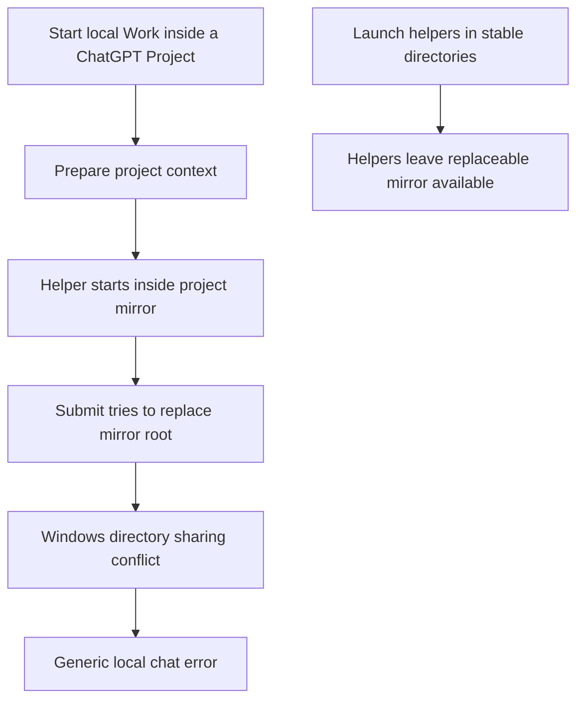

# ChatGPT / Codex Project → Local Work: Windows workaround

[中文说明](README.zh-CN.md) · [Setup](docs/SETUP.md) · [Related reports](docs/REFERENCES.md) · [Verification](docs/VERIFICATION.md)

For the desktop error **“Could not use this project for a local chat”** / **“无法将此项目用于本地聊天”** when creating local Work inside a ChatGPT Project or changing Chat to Work.

**Community workaround, not an official OpenAI fix.** This repository documents a Windows case recovered on **2026-10-03**, with original helper-launcher source and sanitized evidence. It does not patch the application or publish private project data.

## Symptoms

- Chat inside a cloud ChatGPT Project works.
- Creating local Work inside that Project fails before a usable first turn, or switching Chat to Work fails.
- The desktop displays the error above, sometimes with “Could not sync ChatGPT project context”.
- Existing Work or Work outside the Project may still work.
- Restarting, reinstalling, or creating an empty Project is not a reliable universal remedy. Different failures can share the same toast.

## What went wrong in the investigated case

The installed application synchronized context by staging a new mirror and replacing the entire existing mirror directory. A browser helper and its interpreter used that directory as their current working directory and held directory handles. A non-destructive Windows access probe returned sharing violation **32**.

The first attempt moved `node_repl` to a stable directory and edited `cua_repl.cwd` in the plugin cache. After a full application restart, the shared `node_repl` setting remained effective, but the generated browser manifest had lost `cwd`. The browser stack again ran inside the mirror, and normal task creation failed.

This matches a known family of [directory-lock reports](https://github.com/openai/codex/issues/46898) and [cache-based workaround regressions](https://github.com/openai/codex/issues/48534). It does **not** establish that every `stage=filesystem` error has this cause.

## Workaround used here

1. Put `node_repl.cwd` in a shared configuration **outside each replaceable mirror**.
2. Make that shared configuration discoverable with a root marker and a narrowly scoped trust entry.
3. Use a **complete user-configured `cua_repl` server** to take precedence over the same-named plugin server, after verifying that behavior on the installed version.
4. Launch the original bundled browser runtime through [scripts/start-cua-stable.mjs](scripts/start-cua-stable.mjs). The launcher reads the generated plugin manifest at startup and uses its current executable, arguments and environment, while keeping both launcher and children in a stable directory.
5. Preserve the original tool policy. Do not use an incomplete `cwd`-only plugin override or disable the browser to make the error disappear.

See [the setup guide](docs/SETUP.md). There is **no automatic installer**: existing settings must be merged and the actual active runtime inspected. The workaround changes helper working directories; use absolute paths when accessing project files.

## Evidence and limits

Inspected Windows desktop display version: **26.930.31730**, build **12947**. Store package: **26.930.3930.0**. A version number is a record of this case, not a claim that every installation of that version is affected.

| Check | Observed result |
| --- | --- |
| Target error log | Project sync failed at `stage=filesystem`, including a case with zero sources |
| Failing process state | Browser helper and interpreter cwd/handles pointed into a project mirror |
| Directory access probe | Sharing violation 32 before recovery; 0 after old helpers exited |
| Shared configuration | All six visible Project target paths inherited both stable helper settings |
| One not-yet-created mirror | Its target path still discovered the shared configuration; no empty mirror was fabricated |
| Effective server listing | The user-configured browser launcher won while plugin manifest `cwd` remained absent |
| Independent browser helper startup | MCP initialization and tool inventory succeeded; launcher and both descendants used the stable directory |
| Normal Project composer | User confirmed successful entry into local Work in one existing Project |
| Actual new-task helpers | Both helper stacks used stable directories; no helper cwd remained inside a mirror |
| Other five Project composers | Not individually tested |
| Full restart after the final change | Not yet retested |
| Another computer / macOS / Linux / future updates | Not verified |

The exact failing rename's operating-system error was not captured in the desktop log; the process/handle observations and sharing probe are evidence for the lock mechanism. Configuration reads alone were not called UI success. The old helpers exited on their own; user helpers were not force-killed. Only separately created diagnostic processes were cleaned up.

The launcher currently selects the numerically newest cached plugin version. Only a single cached version was present in the investigated environment. Multiple caches, application downgrades, tool-policy changes and future releases need another review. This approach avoids depending on an edited cache `cwd`; it does not prove permanent update compatibility.

## Public reports

The five directly related issues checked on 2026-10-03 were open: [#34499](https://github.com/openai/codex/issues/34499), [#35127](https://github.com/openai/codex/issues/35127), [#44736](https://github.com/openai/codex/issues/44736), [#46898](https://github.com/openai/codex/issues/46898), [#48534](https://github.com/openai/codex/issues/48534).

The earliest exact-error report verified in this investigation was created on **2026-07-21**. A claim that the same issue was reported in 2025 was not substantiated. Issue status is a dated snapshot; it does not by itself prove whether every release has or has not fixed the problem.

Author attribution, dates, community fallback and official documentation are in [REFERENCES.md](docs/REFERENCES.md). Linked issue bodies are user reports, not automatically OpenAI-confirmed diagnoses. Please consult the live links for updates.

## Contributing

If reproducing or improving this method, record the display/package versions, effective server source and cwd, **normal composer outcome**, repeated attempts, restart/update outcome, and any remaining watcher locks. A new report is welcome through this repository's issue template.

Share redacted evidence only. Local configuration, authentication files, project content, screenshots with project names, machine profiles and raw logs are intentionally absent from this release.

## License and affiliation

Original documentation and launcher/snippet-generator source: [MIT](LICENSE). Linked third-party reports retain their authors' rights and are not relicensed by this repository. No OpenAI runtime or application source is redistributed. This project is not affiliated with or endorsed by OpenAI.
